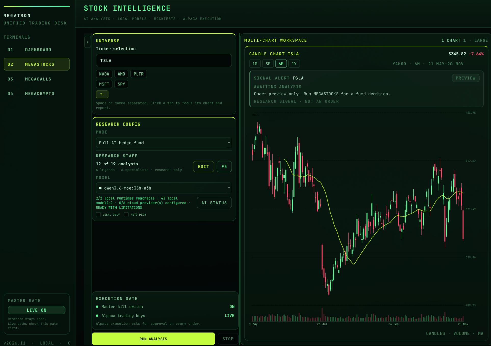
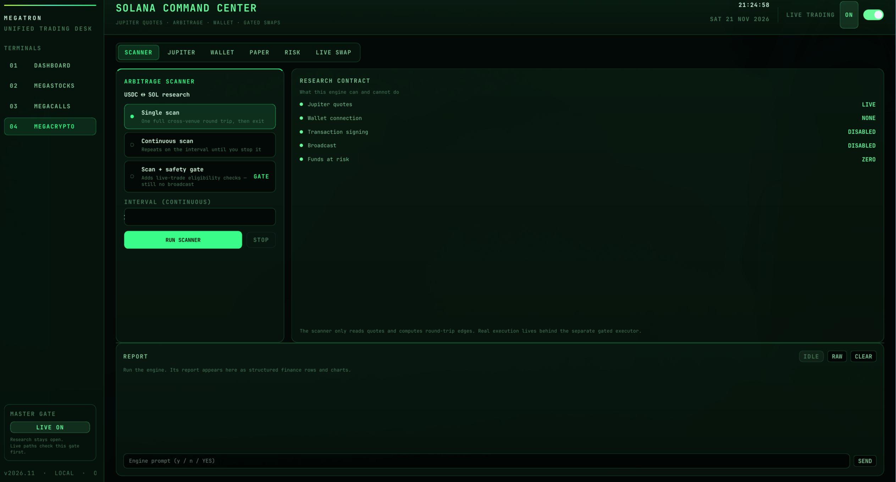

<p align="center">
  
</p>

# MEGATRON — AI Hedge Fund Desk

An AI-powered equity research and trading desk. MEGATRON wraps the
[AI Hedge Fund](https://github.com/virattt/ai-hedge-fund) analyst engine with a native
desktop terminal, a web application, a CLI, a backtester, and opt-in live execution.

> **Educational and research use only.** This is not investment advice. Nothing here
> is guaranteed to make money. Live trading is opt-in, gated, and off by default.

## Screenshots

[](assets/screenshots/megastocks-desktop.png)

*MEGASTOCKS — stock intelligence desk with multi-ticker research, a candlestick workspace and a gated execution panel.*

[](assets/screenshots/megacrypto-solana.png)

*MEGACRYPTO — Solana command center with an arbitrage scanner and its own execution gate.*

## What is in the box

| Surface | What it does |
|---------|--------------|
| **MEGATRON desktop** (PySide6) | MEGASTOCKS research desk with per-ticker charts, analyst roster, model picker and isolated research tabs; MEGACALLS covered-call scanner; MEGACRYPTO Solana scanner |
| **Web app** (React + FastAPI) | Flow-based dashboard to run the hedge fund and backtester, stream reasoning, and manage API keys |
| **CLI** (`src/main.py`) | Run the analyst graph for any ticker universe |
| **Backtester** (`src/backtester.py`) | Replay the same analysts over a date range |
| **`v2/`** | Work-in-progress quantitative stack: point-in-time data, event studies, signals, CPCV/PBO validation, portfolio and risk modules |

The research engine ships with 18 investor and specialist agents (Buffett, Munger,
Graham, Lynch, Burry, Wood, Druckenmiller, Damodaran and others), plus valuation,
sentiment, fundamentals, technicals, growth, risk and portfolio-manager nodes.

## Requirements

- **Python 3.11 or 3.12** (the lockfile and tests target 3.12)
- **Poetry 2.x**
- **Node.js 18+** and npm for the web app
- **Ollama** (optional) for fully local LLM research
- **Docker** (optional) for the containerized CLI
- At least one LLM provider key, or a local Ollama model, for agent research

## Install

```bash
git clone https://github.com/shadow640lc-dow/ai-stocks.git
cd ai-stocks
cp .env.example .env     # then add the keys you actually use
poetry install
```

Key facts about configuration:

- Research runs without broker keys. Without `FINANCIAL_DATASETS_API_KEY`, the data
  layer falls back to Yahoo Finance where it can.
- Set **one** LLM provider (`OPENAI_API_KEY`, `ANTHROPIC_API_KEY`, `GROQ_API_KEY`,
  `DEEPSEEK_API_KEY`, `GOOGLE_API_KEY`, `XAI_API_KEY`) or run against Ollama.
- Never commit `.env`. It is gitignored, along with `.live_trading`, databases,
  logs, caches and local backups.

## Run

### Desktop terminal

```bash
./run_gui.sh
```

The first run creates `.venv-gui` and installs PySide6-Essentials. The GUI drives the
existing engines (`megastocks.py`, `megacalls.py`, `megacrypto.py`) through the Poetry
environment; it does not reimplement them. See
[megatron_gui/README.md](megatron_gui/README.md) for controls and layout.

### Web application

```bash
./app/run.sh
```

Or manually:

```bash
# terminal 1 — API (from the repo root)
poetry run uvicorn app.backend.main:app --reload --host 127.0.0.1 --port 8000

# terminal 2
cd app/frontend && npm install && npm run dev
```

- Frontend: <http://localhost:5173>
- API docs: <http://localhost:8000/docs>

### CLI

```bash
poetry run python src/main.py --ticker NVDA,AMD,PLTR,MSFT
poetry run python src/main.py --ticker NVDA,AMD --ollama
poetry run python src/main.py --ticker AAPL --start-date 2024-01-01 --end-date 2024-03-01
```

### Backtester

```bash
poetry run python src/backtester.py --ticker NVDA,AMD,MSFT --start-date 2024-01-01
```

### Docker (CLI)

```bash
cd docker
./run.sh --ticker AAPL,MSFT,NVDA main
./run.sh --ticker AAPL,MSFT,NVDA --ollama main
./run.sh --ticker AAPL,MSFT,NVDA backtest
```

`docker/run.sh` also supports `build`, `compose`, `ollama` and `pull <model>`.

## Live trading safety

Live orders are **off by default** and layered behind independent gates:

1. `.live_trading` must contain `ON`; a missing file means OFF.
2. The command must explicitly pass `--alpaca` (or the GUI's LIVE mode).
3. `ALPACA_MODE` defaults to `paper`; keep it there unless you mean otherwise.
4. `ALPACA_MAX_NOTIONAL` caps a single order.
5. Each order is confirmed individually, and orders are refused after the switch is
   turned off.

`MEGATRON_LIVE_EXECUTION=false` adds a second gate for the Solana swap path. No
credential is required to run research, backtests or the scanners in watch-only mode.

## Project layout

```
src/            analyst graph, CLI, backtester, data, execution
app/backend/    FastAPI service
app/frontend/   React + Vite dashboard
megatron_gui/   native desktop terminal
megacalls.py    covered-call scanner
megacrypto.py   Solana scanner launcher
crypto_arb/     Solana arb scanner and gated executor
v2/             quantitative research stack (work in progress)
tests/          engine, safety and backtest tests
docker/         container build and compose stack
```

## Verify a checkout

```bash
poetry run pytest                                   # engine + safety suite
cd app/frontend && npm run build                    # typecheck + production build
QT_QPA_PLATFORM=offscreen ../.venv-gui/bin/python -c "import megatron_gui.main"
```

## Contributing

Issues and pull requests are welcome at
<https://github.com/shadow640lc-dow/ai-stocks/issues>. Keep changes focused, add tests
for engine behavior, and update the roadmap status when you ship an item from
[ROADMAP.md](ROADMAP.md).

## Credits and license

Built on [AI Hedge Fund](https://github.com/virattt/ai-hedge-fund) by Virat Singh,
used under the MIT License. The investor personas are stylized approximations of
public investment philosophies — not the individuals, and not endorsements.
See [LICENSE](LICENSE).
